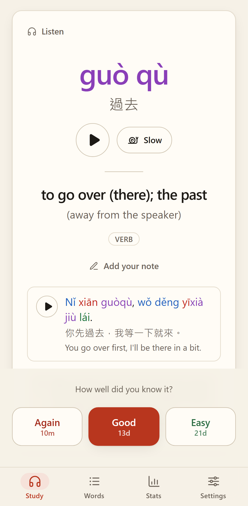
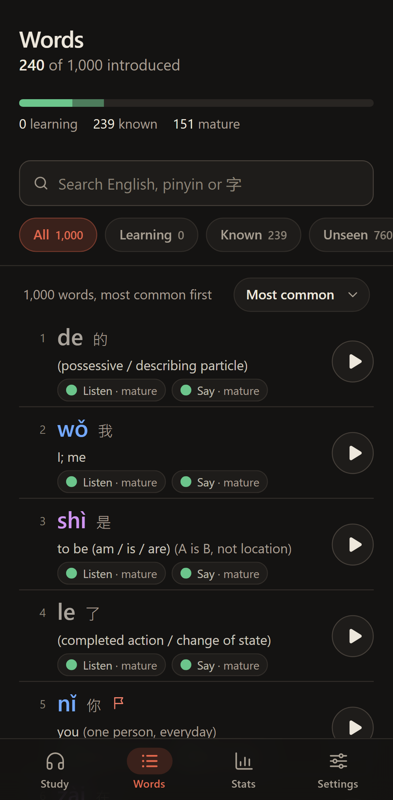
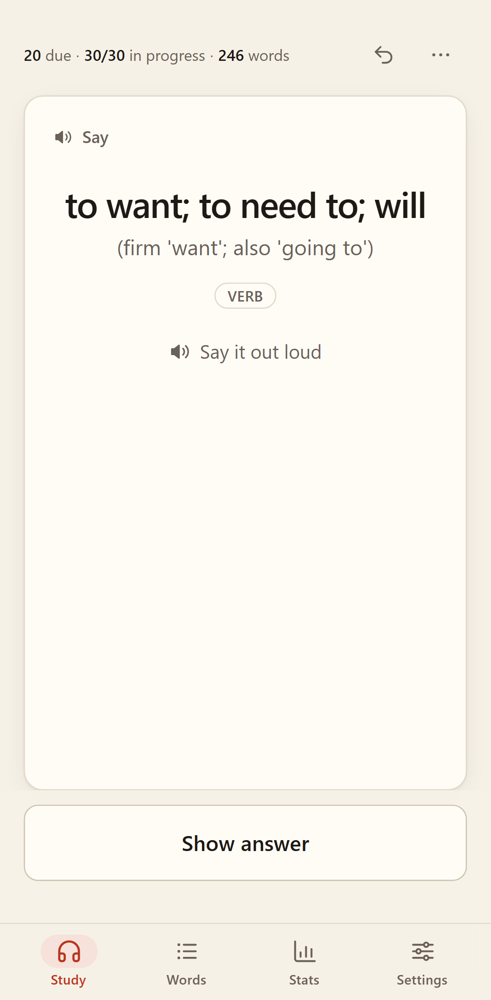

# 千 qian

**Learn the 1000 most common Mandarin words by ear.**

qian (千, "thousand") is a flashcard app for someone who already speaks some Mandarin, can't read, and doesn't want to learn to. Every card is built around **hearing** the word. Tone-colored pinyin is the visual aid, English gives the meaning, and characters are shown small and muted. The language is **Taiwan Mandarin**: Traditional characters, Taiwan vocabulary (計程車, 腳踏車, 垃圾 lèsè) and Taiwan standard readings checked against the MOE dictionary.

Live at **https://dmilin1.github.io/qian/**. It installs as an app (PWA) and works offline.

<p>
  
  
  
</p>

More screenshots of every page, on phone and desktop in light and dark, are in [`docs/screenshots/`](docs/screenshots).

- **[DECISIONS.md](DECISIONS.md)**: every judgment call (word list, readings, audio, scheduler, storage, hosting) and where the app differs from [PLAN.md](PLAN.md).
- **[NATIVE-CHECK.md](NATIVE-CHECK.md)**: a short, prioritized list of recordings and readings for a native Taiwanese speaker to check.

## Features

- **Two cards per word, scheduled separately.**
  - **Listen** (中→EN): the word plays automatically, with pinyin and characters underneath. A setting makes the front audio-only.
  - **Say** (EN→中): an English prompt with a disambiguating hint. You say the word out loud, then reveal the pinyin and hear it.
- **Audio first.** One Taiwan Mandarin voice (ElevenLabs "Anna Su") for every word and example sentence, with replay and slow (0.7×, pitch kept) buttons. If a clip is missing, the browser's own zh-TW voice reads it instead.
- **Grading:** Again / Good / Easy, plus **"I already know this"** the first time a word appears. Undo, suspend a word, or flag a card (bad audio, wrong pinyin, unclear meaning…). Open flags can be exported as a CSV from *Stats → Flagged cards*.
- **Your own notes.** Add your own meaning or a way to remember a word (N, or *Add your note* on the answer or the word page). It shows next to the English: on the Listen answer and on the Say card's prompt. Words search also matches your notes.
- **Hear it in a sentence.** A Listen card's front has an *In a sentence* button (E) that plays the example sentence as a hint, audio only, since a word can sound a little different in context. Say cards don't offer it before reveal, because it would give the answer away.
- **Notes for grammar words and polyphones.** Characters quoted in a note get their pinyin added when shown, so notes work without reading.
- **No daily quota.** New words arrive as the words you are learning become stable (see below). The session is endless. When nothing is at risk, you can keep practicing ahead.
- **Words:** all 1000 words, searchable by English, characters, rank (`#40`) or pinyin with or without tones (`ni hao`, `ni3hao3`, `nǐ hǎo`), with filters, sorting (due soonest, weakest, most forgotten…) and per-word history.
- **Stats:** progress per direction, daily review heatmap, streak, time studied, accuracy over time for Listen vs Say, a review forecast and your hardest words.
- **Your data stays on your device** (IndexedDB). Export and import a backup file to move between devices.
- Light and dark themes (following the system by default), phone and desktop layouts, keyboard shortcuts, offline audio download.

### Keyboard shortcuts (Study)

| Key | Action |
|---|---|
| Space / Enter | Show the answer, or replay once it is shown |
| 1 / 2 / 3 | Again / Good / Easy |
| R, S | Replay, replay slowly |
| E | Play the example sentence (a hint before reveal on Listen cards) |
| K | I already know this (new words) |
| N | Add or edit your note |
| Z | Undo the last answer |

## How the scheduler works

- Each card has an [FSRS](https://github.com/open-spaced-repetition/ts-fsrs) memory state (stability, difficulty). From it the app computes the card's current recall probability.
- **The next card** is sampled from the cards at risk, weighted toward the lowest recall probability, with a little randomness. A word's Listen and Say cards are not shown back to back.
- **New words enter by mastery, not by date.** The app keeps a working set of "unstable" words: in learning, or with stability under *Stable after* (default 5 days). A new word, the next by frequency, is introduced only when the working set is below *Words in progress* (default 30) **and** due reviews are at or under *Backlog limit* (default 10). Missing days never causes a flood of new words; a backlog just means reviews first.
- The Listen card is introduced first. The Say card becomes eligible once the Listen card has graduated from learning.
- The Say card waits until a later study day (the day starts at 4am), so it is never answered from short-term memory.
- "I already know this" grades both cards Easy, so the word comes back for a check in about a week.
- Target retention (default 90%), the working-set size and the other knobs are in Settings.

**Data model.** The source of truth is an append-only event log (reviews, "known", suspend, flag, your notes), stored in IndexedDB. Card states are derived by replaying the log through FSRS, so they can always be rebuilt. Settings live in `localStorage`.

## Local development

Requires Node 24.

```bash
npm install
npm run dev          # http://localhost:5173/ (no service worker in dev)
```

| Command | What it does |
|---|---|
| `npm run lint` | oxlint |
| `npm run typecheck` | `tsc -b` (app, configs and e2e) |
| `npm test` | Vitest unit and component tests (`src/**/*.test.ts(x)`) |
| `npm run build` | type-check and production build into `dist/` (base `/qian/`) |
| `npm run preview` | serve `dist/` at http://localhost:4173/qian/ |
| `npm run test:e2e` | Playwright end-to-end tests (builds and previews automatically) |
| `npm run generate-pwa-assets` | regenerate the PNG icons in `public/` from `public/favicon.svg` |

On Windows, run Vitest from PowerShell (or a shell whose working directory starts with an uppercase `C:`). From Git Bash's `/c/...` paths Vitest loads twice and every suite fails.

### End-to-end tests

```bash
npx playwright install chromium webkit   # once
npm run test:e2e
```

The suite runs against the production build under `/qian/` in three projects: Desktop Chrome, Pixel 7 (mobile Chrome) and iPhone 14 (WebKit). It covers the study flow (autoplay, reveal, grade, undo, "I already know this", audio-only front, Say cards, keyboard shortcuts), the Words search and word detail, Stats with seeded history, export → reset → import, persistence across reloads, hash deep links, the PWA manifest, the service worker and offline mode. Any console error fails the test. Most tests stub audio in the page and assert that playback was *attempted*; `e2e/audio.spec.ts` and the offline-audio test in `e2e/pwa.spec.ts` play the real recorded clips through `<audio>` and check that no browser-voice fallback was used. The screenshot spec (`e2e/screenshots.spec.ts`) rewrites `docs/screenshots/` on every run, after importing ten weeks of history generated by the app's own scheduler. To regenerate only the screenshots, run `npx playwright test e2e/screenshots.spec.ts`.

At release (2026-10-11): Vitest 354 tests in 33 files; Playwright 99 tests, of which 89 pass and 10 are skipped by design (desktop-only keyboard tests on phones, and the Chromium-only PWA and screenshot tests on WebKit).

## Data pipeline

Build-time Python scripts in `scripts/` produce the committed app data. Use the project venv (`.venv`, Python 3.11; pinned packages in `scripts/requirements.txt`) and set `PYTHONIOENCODING=utf-8` when printing Chinese.

```bash
# 0. Once: create the venv and install the pinned packages
python -m venv .venv
./.venv/Scripts/python -m pip install -r scripts/requirements.txt --index-url https://pypi.org/simple
# 1. Candidates: SUBTLEX-CH + wordfreq blend, OpenCC s2twp, CC-CEDICT and MOE readings -> data/candidates.json
./.venv/Scripts/python scripts/data/build_candidates.py
# 2. Final 1000 (drops, Taiwan substitutions, sanity sweep) -> data/selected.json, data/selection-log.md
./.venv/Scripts/python scripts/data/select_words.py
# 3. Merge the reviewed enrichment chunks (gloss, hint, note, example...) -> src/data/words.json
./.venv/Scripts/python scripts/data/build_words.py            # --check to validate only
# Review Say-card prompts whose English overlaps
./.venv/Scripts/python scripts/data/prompt_groups.py
```

Other data tools: `scripts/data/rechunk.py` (re-rank the authored chunks after the selection changes, `--add` for new entries), `scripts/data/pinyin_spacing.py` and `polish_style.py` (example-pinyin spacing and text style; `--write` applies).

Word ids are stable (`ids.lock.json`), so progress survives re-ranking or edits. The data contract is `src/data/types.ts`, the method and every judgment call are in `data/NOTES.md`, and the final audit is `data/AUDIT.md`. `src/data/words.json` and the audio are the released data: change them only through these scripts.

## Audio generation

Audio is generated with the ElevenLabs API. Put the key in `.env.local` as `ELEVENLABS_API_KEY=...`. That file is gitignored, and the key is only read by the Python scripts, never bundled into the app.

```bash
PYTHONIOENCODING=utf-8 ./.venv/Scripts/python scripts/audio/generate.py --dry-run   # plan + worst-case credit cost
PYTHONIOENCODING=utf-8 ./.venv/Scripts/python scripts/audio/generate.py             # full run; resumable and idempotent
./.venv/Scripts/python scripts/audio/qc.py --all                                    # re-run QC on existing clips (report only)
./.venv/Scripts/python scripts/audio/rescore.py                                     # re-score cached attempts after a QC change (no credits)
PYTHONIOENCODING=utf-8 ./.venv/Scripts/python scripts/audio/generate.py --manifest-only  # rebuild manifest + flags (no API calls)
./.venv/Scripts/python -m pytest scripts/audio/tests -q                              # audio toolchain tests
```

`scripts/audio/overrides.json` sends a same-sound word to the TTS for a few polyphones (和 → 河, 教 → 交…), and `scripts/audio/reviews.json` holds the human review notes copied into `flags.json`. The released audio cost 1,240 ElevenLabs credits in total.

Each word gets a word clip and an example-sentence clip (`public/audio/w|s/<id>-<hash8>.mp3`, mono 48 kbps MP3, about 16 MB in total; `<hash8>` comes from the mp3 bytes, so a replaced clip gets a new URL and no cache keeps serving the old one. Replace clips only through `scripts/audio/generate.py`, see `scripts/audio/NOTES.md`) and an entry in `src/data/audio-manifest.json`. Every clip is QC'd with speech-to-text and, for single words, a pitch-contour check against the expected tones. Failures are regenerated, and anything still failing is listed in `scripts/audio/flags.json` for a human to listen to. Options, costs and the model choice are in `scripts/audio/NOTES.md`.

## Deployment

Pushing to `main` (or running the workflow manually) runs `.github/workflows/deploy.yml`: `npm ci` → lint → Vitest → audio check → build → upload `dist/` → deploy to GitHub Pages. One-time repo setting: **Settings → Pages → Source: GitHub Actions**.

- The audio check (`node scripts/check-audio.mjs`) fails the deploy when `src/data/audio-manifest.json` covers less than 99% of the word and example clips, or lists a clip that is missing from `public/audio/`. Without the clips every word would play through the browser's built-in voice. All 2000 clips are generated (100% coverage); commit `public/audio/`, the manifest, `scripts/audio/state.json` and `scripts/audio/flags.json` together. To deploy without recordings on purpose, set `MIN_AUDIO_COVERAGE=0` for that step (this also skips the missing-file check).
- Playwright does not run in CI. Run `npm run test:e2e` locally before a release.

- The Vite `base` is `/qian/` for `build` and `preview`, and routing uses the hash (`/qian/#/words`), so Pages needs no 404 fallback.
- The service worker (vite-plugin-pwa, Workbox `generateSW`) precaches the app shell and the word data. It does **not** precache audio: clips are cached on first play (CacheFirst, cache `qian-audio`), or all at once with *Settings → Audio → Download all audio*. When a new version is deployed, an open app shows a small "new version / Reload" toast.

## Your data: export and import

- *Settings → Your data → Export backup* saves `qian-backup-YYYY-MM-DD.json`: the full event log, settings and flags, with a schema version. On phones there is also a Share / Save to Files option.
- **Import → Merge** (recommended) unions the backup's log with this device's (duplicates are skipped by event id) and replays it. Merging is safe to repeat and is how you sync two devices. **Replace** adopts the backup's log and settings instead.
- Browsers can evict site data. The app asks for persistent storage. On iPhone, install it to the home screen (Safari deletes the data of sites you haven't visited in 7 days) and export now and then.

## Credits and licenses

- Word frequencies: [SUBTLEX-CH](https://www.ugent.be/pp/experimentele-psychologie/en/research/documents/subtlexch) (Cai & Brysbaert, 2010, *PLoS ONE* 5(6): e10729; free for research use, cited as requested) and [wordfreq](https://github.com/rspeer/wordfreq) (data CC BY-SA 4.0).
- Readings and meanings: [CC-CEDICT](https://cc-cedict.org/) (CC BY-SA 4.0) and the [MOE Revised Mandarin Dictionary](https://dict.revised.moe.edu.tw/) via [g0v moedict-data](https://github.com/g0v/moedict-data) (CC BY-ND 3.0 TW, © Ministry of Education, Taiwan; only factual reading fields are used).
- Conversion: [OpenCC](https://github.com/BYVoid/OpenCC) (Apache 2.0).
- Glosses, hints, notes and example sentences were written for qian and checked against those dictionaries. Because they draw on CC-CEDICT, the word data (`src/data/words.json`) is shared under **CC BY-SA 4.0**.
- Audio: generated with [ElevenLabs](https://elevenlabs.io/), voice "Anna Su" (Taiwan Mandarin).
- Scheduling: [ts-fsrs](https://github.com/open-spaced-repetition/ts-fsrs) (MIT). Built with React, React Router, Vite, Tailwind CSS, idb, Recharts, vite-plugin-pwa / Workbox, Vitest and Playwright.
